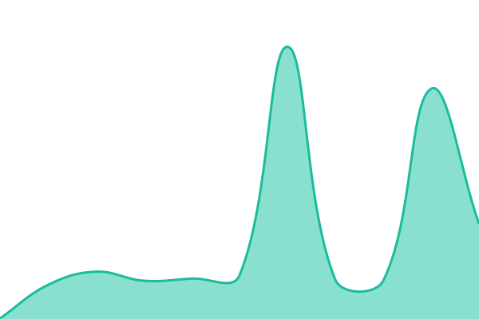

# [📈 Live Status](https://demo.upptime.js.org): <!--live status--> **🟧 Partial outage**

This repository contains the open-source uptime monitor and status page for [EpizMC](https://demo.upptime.js.org), powered by [Upptime](https://github.com/upptime/upptime).

With [Upptime](https://upptime.js.org), you can get your own unlimited and free uptime monitor and status page, powered entirely by a GitHub repository. We use [Issues](https://github.com/EpizMC/uptime/issues) as incident reports, [Actions](https://github.com/EpizMC/uptime/actions) as uptime monitors, and [Pages](https://demo.upptime.js.org) for the status page.

<!--start: status pages-->
<!-- This summary is generated by Upptime (https://github.com/upptime/upptime) -->
<!-- Do not edit this manually, your changes will be overwritten -->
<!-- prettier-ignore -->
| URL | Status | History | Response Time | Uptime |
| --- | ------ | ------- | ------------- | ------ |
|  [Google](https://www.google.com) | 🟩 Up | [google.yml](https://github.com/EpizMC/uptime/commits/HEAD/history/google.yml) | 

 130ms
     
 | 

<a href="https://EpizMC.github.io/uptime/history/google">100.00%</a>
    

|  [Wikipedia](https://en.wikipedia.org) | 🟩 Up | [wikipedia.yml](https://github.com/EpizMC/uptime/commits/HEAD/history/wikipedia.yml) | 

 151ms
     
 | 

<a href="https://EpizMC.github.io/uptime/history/wikipedia">100.00%</a>
    

|  [YouTube](https://www.youtube.com) | 🟩 Up | [you-tube.yml](https://github.com/EpizMC/uptime/commits/HEAD/history/you-tube.yml) | 

 235ms
     
 | 

<a href="https://EpizMC.github.io/uptime/history/you-tube">100.00%</a>
    

|  [GitHub](https://github.com) | 🟩 Up | [git-hub.yml](https://github.com/EpizMC/uptime/commits/HEAD/history/git-hub.yml) | 

 47ms
     
 | 

<a href="https://EpizMC.github.io/uptime/history/git-hub">100.00%</a>
    

|  [Reddit](https://www.reddit.com) | 🟥 Down | [reddit.yml](https://github.com/EpizMC/uptime/commits/HEAD/history/reddit.yml) | 

 40ms
     
 | 

<a href="https://EpizMC.github.io/uptime/history/reddit">2.38%</a>
    

|  [Discord](https://discord.com) | 🟩 Up | [discord.yml](https://github.com/EpizMC/uptime/commits/HEAD/history/discord.yml) | 

 65ms
     
 | 

<a href="https://EpizMC.github.io/uptime/history/discord">100.00%</a>
    

|  [Twitch](https://www.twitch.tv) | 🟩 Up | [twitch.yml](https://github.com/EpizMC/uptime/commits/HEAD/history/twitch.yml) | 

 59ms
     
 | 

<a href="https://EpizMC.github.io/uptime/history/twitch">100.00%</a>
    

|  [Facebook](https://www.facebook.com) | 🟩 Up | [facebook.yml](https://github.com/EpizMC/uptime/commits/HEAD/history/facebook.yml) | 

 247ms
     
 | 

<a href="https://EpizMC.github.io/uptime/history/facebook">100.00%</a>
    

|  [Instagram](https://www.instagram.com) | 🟩 Up | [instagram.yml](https://github.com/EpizMC/uptime/commits/HEAD/history/instagram.yml) | 

 273ms
     
 | 

<a href="https://EpizMC.github.io/uptime/history/instagram">100.00%</a>
    

|  [X](https://x.com) | 🟩 Up | [x.yml](https://github.com/EpizMC/uptime/commits/HEAD/history/x.yml) | 

 108ms
     
 | 

<a href="https://EpizMC.github.io/uptime/history/x">100.00%</a>
    

|  [TikTok](https://www.tiktok.com) | 🟩 Up | [tik-tok.yml](https://github.com/EpizMC/uptime/commits/HEAD/history/tik-tok.yml) | 

 288ms
     
 | 

<a href="https://EpizMC.github.io/uptime/history/tik-tok">100.00%</a>
    

|  [LinkedIn](https://www.linkedin.com) | 🟩 Up | [linked-in.yml](https://github.com/EpizMC/uptime/commits/HEAD/history/linked-in.yml) | 

 340ms
     
 | 

<a href="https://EpizMC.github.io/uptime/history/linked-in">100.00%</a>
    

|  [Pinterest](https://www.pinterest.com) | 🟩 Up | [pinterest.yml](https://github.com/EpizMC/uptime/commits/HEAD/history/pinterest.yml) | 

 325ms
     
 | 

<a href="https://EpizMC.github.io/uptime/history/pinterest">100.00%</a>
    

|  [Snapchat](https://www.snapchat.com) | 🟩 Up | [snapchat.yml](https://github.com/EpizMC/uptime/commits/HEAD/history/snapchat.yml) | 

 110ms
     
 | 

<a href="https://EpizMC.github.io/uptime/history/snapchat">100.00%</a>
    

|  [Threads](https://www.threads.net) | 🟩 Up | [threads.yml](https://github.com/EpizMC/uptime/commits/HEAD/history/threads.yml) | 

 294ms
     
 | 

<a href="https://EpizMC.github.io/uptime/history/threads">100.00%</a>
    

|  [Tumblr](https://www.tumblr.com) | 🟩 Up | [tumblr.yml](https://github.com/EpizMC/uptime/commits/HEAD/history/tumblr.yml) | 

 44ms
     
 | 

<a href="https://EpizMC.github.io/uptime/history/tumblr">100.00%</a>
    

|  [Medium](https://medium.com) | 🟥 Down | [medium.yml](https://github.com/EpizMC/uptime/commits/HEAD/history/medium.yml) | 

 25ms
     
 | 

<a href="https://EpizMC.github.io/uptime/history/medium">2.63%</a>
    

|  [Quora](https://www.quora.com) | 🟥 Down | [quora.yml](https://github.com/EpizMC/uptime/commits/HEAD/history/quora.yml) | 

 31ms
     
 | 

<a href="https://EpizMC.github.io/uptime/history/quora">2.48%</a>
    

|  [Stack Overflow](https://stackoverflow.com) | 🟥 Down | [stack-overflow.yml](https://github.com/EpizMC/uptime/commits/HEAD/history/stack-overflow.yml) | 

 126ms
     
 | 

<a href="https://EpizMC.github.io/uptime/history/stack-overflow">2.77%</a>
    

|  [Stack Exchange](https://stackexchange.com) | 🟩 Up | [stack-exchange.yml](https://github.com/EpizMC/uptime/commits/HEAD/history/stack-exchange.yml) | 

 92ms
     
 | 

<a href="https://EpizMC.github.io/uptime/history/stack-exchange">100.00%</a>
    

|  [GitLab](https://gitlab.com) | 🟩 Up | [git-lab.yml](https://github.com/EpizMC/uptime/commits/HEAD/history/git-lab.yml) | 

 180ms
     
 | 

<a href="https://EpizMC.github.io/uptime/history/git-lab">100.00%</a>
    

|  [Bitbucket](https://bitbucket.org) | 🟩 Up | [bitbucket.yml](https://github.com/EpizMC/uptime/commits/HEAD/history/bitbucket.yml) | 

 432ms
     
 | 

<a href="https://EpizMC.github.io/uptime/history/bitbucket">100.00%</a>
    

|  [CodePen](https://codepen.io) | 🟥 Down | [code-pen.yml](https://github.com/EpizMC/uptime/commits/HEAD/history/code-pen.yml) | 

 26ms
     
 | 

<a href="https://EpizMC.github.io/uptime/history/code-pen">2.75%</a>
    

|  [Replit](https://replit.com) | 🟩 Up | [replit.yml](https://github.com/EpizMC/uptime/commits/HEAD/history/replit.yml) | 

 101ms
     
 | 

<a href="https://EpizMC.github.io/uptime/history/replit">100.00%</a>
    

|  [JSFiddle](https://jsfiddle.net) | 🟩 Up | [js-fiddle.yml](https://github.com/EpizMC/uptime/commits/HEAD/history/js-fiddle.yml) | 

 110ms
     
 | 

<a href="https://EpizMC.github.io/uptime/history/js-fiddle">100.00%</a>
    

|  [npm](https://www.npmjs.com) | 🟥 Down | [npm.yml](https://github.com/EpizMC/uptime/commits/HEAD/history/npm.yml) | 

 24ms
     
 | 

<a href="https://EpizMC.github.io/uptime/history/npm">2.86%</a>
    

|  [PyPI](https://pypi.org) | 🟩 Up | [py-pi.yml](https://github.com/EpizMC/uptime/commits/HEAD/history/py-pi.yml) | 

 32ms
     
 | 

<a href="https://EpizMC.github.io/uptime/history/py-pi">100.00%</a>
    

|  [Docker Hub](https://hub.docker.com) | 🟩 Up | [docker-hub.yml](https://github.com/EpizMC/uptime/commits/HEAD/history/docker-hub.yml) | 

 98ms
     
 | 

<a href="https://EpizMC.github.io/uptime/history/docker-hub">100.00%</a>
    

|  [Cloudflare](https://www.cloudflare.com) | 🟩 Up | [cloudflare.yml](https://github.com/EpizMC/uptime/commits/HEAD/history/cloudflare.yml) | 

 77ms
     
 | 

<a href="https://EpizMC.github.io/uptime/history/cloudflare">100.00%</a>
    

|  [Vercel](https://vercel.com) | 🟩 Up | [vercel.yml](https://github.com/EpizMC/uptime/commits/HEAD/history/vercel.yml) | 

 172ms
     
 | 

<a href="https://EpizMC.github.io/uptime/history/vercel">100.00%</a>
    

|  [Netlify](https://www.netlify.com) | 🟩 Up | [netlify.yml](https://github.com/EpizMC/uptime/commits/HEAD/history/netlify.yml) | 

 209ms
     
 | 

<a href="https://EpizMC.github.io/uptime/history/netlify">100.00%</a>
    

|  [Render](https://render.com) | 🟩 Up | [render.yml](https://github.com/EpizMC/uptime/commits/HEAD/history/render.yml) | 

 160ms
     
 | 

<a href="https://EpizMC.github.io/uptime/history/render">100.00%</a>
    

|  [Railway](https://railway.com) | 🟩 Up | [railway.yml](https://github.com/EpizMC/uptime/commits/HEAD/history/railway.yml) | 

 76ms
     
 | 

<a href="https://EpizMC.github.io/uptime/history/railway">100.00%</a>
    

|  [Firebase](https://firebase.google.com) | 🟩 Up | [firebase.yml](https://github.com/EpizMC/uptime/commits/HEAD/history/firebase.yml) | 

 373ms
     
 | 

<a href="https://EpizMC.github.io/uptime/history/firebase">100.00%</a>
    

|  [Supabase](https://supabase.com) | 🟩 Up | [supabase.yml](https://github.com/EpizMC/uptime/commits/HEAD/history/supabase.yml) | 

 248ms
     
 | 

<a href="https://EpizMC.github.io/uptime/history/supabase">100.00%</a>
    

|  [MDN Web Docs](https://developer.mozilla.org) | 🟩 Up | [mdn-web-docs.yml](https://github.com/EpizMC/uptime/commits/HEAD/history/mdn-web-docs.yml) | 

 76ms
     
 | 

<a href="https://EpizMC.github.io/uptime/history/mdn-web-docs">100.00%</a>
    

|  [W3Schools](https://www.w3schools.com) | 🟩 Up | [w3-schools.yml](https://github.com/EpizMC/uptime/commits/HEAD/history/w3-schools.yml) | 

 224ms
     
 | 

<a href="https://EpizMC.github.io/uptime/history/w3-schools">100.00%</a>
    

|  [freeCodeCamp](https://www.freecodecamp.org) | 🟩 Up | [free-code-camp.yml](https://github.com/EpizMC/uptime/commits/HEAD/history/free-code-camp.yml) | 

 62ms
     
 | 

<a href="https://EpizMC.github.io/uptime/history/free-code-camp">100.00%</a>
    

|  [GeeksforGeeks](https://www.geeksforgeeks.org) | 🟩 Up | [geeksfor-geeks.yml](https://github.com/EpizMC/uptime/commits/HEAD/history/geeksfor-geeks.yml) | 

 142ms
     
 | 

<a href="https://EpizMC.github.io/uptime/history/geeksfor-geeks">100.00%</a>
    

|  [Hacker News](https://news.ycombinator.com) | 🟩 Up | [hacker-news.yml](https://github.com/EpizMC/uptime/commits/HEAD/history/hacker-news.yml) | 

 431ms
     
 | 

<a href="https://EpizMC.github.io/uptime/history/hacker-news">100.00%</a>
    

|  [Product Hunt](https://www.producthunt.com) | 🟥 Down | [product-hunt.yml](https://github.com/EpizMC/uptime/commits/HEAD/history/product-hunt.yml) | 

 26ms
     
 | 

<a href="https://EpizMC.github.io/uptime/history/product-hunt">3.09%</a>
    

|  [Figma](https://www.figma.com) | 🟩 Up | [figma.yml](https://github.com/EpizMC/uptime/commits/HEAD/history/figma.yml) | 

 80ms
     
 | 

<a href="https://EpizMC.github.io/uptime/history/figma">100.00%</a>
    

|  [Canva](https://www.canva.com) | 🟥 Down | [canva.yml](https://github.com/EpizMC/uptime/commits/HEAD/history/canva.yml) | 

 68ms
     
 | 

<a href="https://EpizMC.github.io/uptime/history/canva">3.18%</a>
    

|  [Photopea](https://www.photopea.com) | 🟩 Up | [photopea.yml](https://github.com/EpizMC/uptime/commits/HEAD/history/photopea.yml) | 

 83ms
     
 | 

<a href="https://EpizMC.github.io/uptime/history/photopea">100.00%</a>
    

|  [Unsplash](https://unsplash.com) | 🟥 Down | [unsplash.yml](https://github.com/EpizMC/uptime/commits/HEAD/history/unsplash.yml) | 

 216ms
     
 | 

<a href="https://EpizMC.github.io/uptime/history/unsplash">3.28%</a>
    

|  [Pexels](https://www.pexels.com) | 🟩 Up | [pexels.yml](https://github.com/EpizMC/uptime/commits/HEAD/history/pexels.yml) | 

 63ms
     
 | 

<a href="https://EpizMC.github.io/uptime/history/pexels">100.00%</a>
    

|  [Pixabay](https://pixabay.com) | 🟥 Down | [pixabay.yml](https://github.com/EpizMC/uptime/commits/HEAD/history/pixabay.yml) | 

 27ms
     
 | 

<a href="https://EpizMC.github.io/uptime/history/pixabay">3.36%</a>
    

|  [Giphy](https://giphy.com) | 🟩 Up | [giphy.yml](https://github.com/EpizMC/uptime/commits/HEAD/history/giphy.yml) | 

 204ms
     
 | 

<a href="https://EpizMC.github.io/uptime/history/giphy">100.00%</a>
    

|  [Tenor](https://tenor.com) | 🟩 Up | [tenor.yml](https://github.com/EpizMC/uptime/commits/HEAD/history/tenor.yml) | 

 87ms
     
 | 

<a href="https://EpizMC.github.io/uptime/history/tenor">100.00%</a>
    

|  [Google Drive](https://drive.google.com) | 🟩 Up | [google-drive.yml](https://github.com/EpizMC/uptime/commits/HEAD/history/google-drive.yml) | 

 190ms
     
 | 

<a href="https://EpizMC.github.io/uptime/history/google-drive">100.00%</a>
    

|  [Dropbox](https://www.dropbox.com) | 🟩 Up | [dropbox.yml](https://github.com/EpizMC/uptime/commits/HEAD/history/dropbox.yml) | 

 567ms
     
 | 

<a href="https://EpizMC.github.io/uptime/history/dropbox">100.00%</a>
    

|  [OneDrive](https://onedrive.live.com) | 🟥 Down | [one-drive.yml](https://github.com/EpizMC/uptime/commits/HEAD/history/one-drive.yml) | 

 36ms
     
 | 

<a href="https://EpizMC.github.io/uptime/history/one-drive">3.63%</a>
    

|  [Google Docs](https://docs.google.com) | 🟩 Up | [google-docs.yml](https://github.com/EpizMC/uptime/commits/HEAD/history/google-docs.yml) | 

 215ms
     
 | 

<a href="https://EpizMC.github.io/uptime/history/google-docs">100.00%</a>
    

|  [Google Sheets](https://sheets.google.com) | 🟥 Down | [google-sheets.yml](https://github.com/EpizMC/uptime/commits/HEAD/history/google-sheets.yml) | 

 0ms
     
 | 

<a href="https://EpizMC.github.io/uptime/history/google-sheets">3.73%</a>
    

|  [Google Slides](https://slides.google.com) | 🟥 Down | [google-slides.yml](https://github.com/EpizMC/uptime/commits/HEAD/history/google-slides.yml) | 

 0ms
     
 | 

<a href="https://EpizMC.github.io/uptime/history/google-slides">3.76%</a>
    

|  [Microsoft 365](https://www.microsoft365.com) | 🟩 Up | [microsoft-365.yml](https://github.com/EpizMC/uptime/commits/HEAD/history/microsoft-365.yml) | 

 155ms
     
 | 

<a href="https://EpizMC.github.io/uptime/history/microsoft-365">100.00%</a>
    

|  [Notion](https://www.notion.so) | 🟩 Up | [notion.yml](https://github.com/EpizMC/uptime/commits/HEAD/history/notion.yml) | 

 134ms
     
 | 

<a href="https://EpizMC.github.io/uptime/history/notion">100.00%</a>
    

|  [Trello](https://trello.com) | 🟩 Up | [trello.yml](https://github.com/EpizMC/uptime/commits/HEAD/history/trello.yml) | 

 74ms
     
 | 

<a href="https://EpizMC.github.io/uptime/history/trello">100.00%</a>
    

|  [Asana](https://asana.com) | 🟩 Up | [asana.yml](https://github.com/EpizMC/uptime/commits/HEAD/history/asana.yml) | 

 251ms
     
 | 

<a href="https://EpizMC.github.io/uptime/history/asana">100.00%</a>
    

|  [Monday.com](https://monday.com) | 🟩 Up | [monday-com.yml](https://github.com/EpizMC/uptime/commits/HEAD/history/monday-com.yml) | 

 120ms
     
 | 

<a href="https://EpizMC.github.io/uptime/history/monday-com">100.00%</a>
    

|  [Slack](https://slack.com) | 🟩 Up | [slack.yml](https://github.com/EpizMC/uptime/commits/HEAD/history/slack.yml) | 

 124ms
     
 | 

<a href="https://EpizMC.github.io/uptime/history/slack">100.00%</a>
    

|  [Zoom](https://zoom.us) | 🟩 Up | [zoom.yml](https://github.com/EpizMC/uptime/commits/HEAD/history/zoom.yml) | 

 188ms
     
 | 

<a href="https://EpizMC.github.io/uptime/history/zoom">100.00%</a>
    

|  [Google Meet](https://meet.google.com) | 🟩 Up | [google-meet.yml](https://github.com/EpizMC/uptime/commits/HEAD/history/google-meet.yml) | 

 189ms
     
 | 

<a href="https://EpizMC.github.io/uptime/history/google-meet">100.00%</a>
    

|  [Microsoft Teams](https://www.microsoft.com/microsoft-teams) | 🟩 Up | [microsoft-teams.yml](https://github.com/EpizMC/uptime/commits/HEAD/history/microsoft-teams.yml) | 

 1572ms
     
 | 

<a href="https://EpizMC.github.io/uptime/history/microsoft-teams">100.00%</a>
    

|  [ChatGPT](https://chatgpt.com) | 🟩 Up | [chat-gpt.yml](https://github.com/EpizMC/uptime/commits/HEAD/history/chat-gpt.yml) | 

 536ms
     
 | 

<a href="https://EpizMC.github.io/uptime/history/chat-gpt">100.00%</a>
    

|  [Claude](https://claude.ai) | 🟥 Down | [claude.yml](https://github.com/EpizMC/uptime/commits/HEAD/history/claude.yml) | 

 25ms
     
 | 

<a href="https://EpizMC.github.io/uptime/history/claude">3.76%</a>
    

|  [Gemini](https://gemini.google.com) | 🟩 Up | [gemini.yml](https://github.com/EpizMC/uptime/commits/HEAD/history/gemini.yml) | 

 204ms
     
 | 

<a href="https://EpizMC.github.io/uptime/history/gemini">100.00%</a>
    

|  [Perplexity](https://www.perplexity.ai) | 🟥 Down | [perplexity.yml](https://github.com/EpizMC/uptime/commits/HEAD/history/perplexity.yml) | 

 26ms
     
 | 

<a href="https://EpizMC.github.io/uptime/history/perplexity">4.20%</a>
    

|  [Hugging Face](https://huggingface.co) | 🟩 Up | [hugging-face.yml](https://github.com/EpizMC/uptime/commits/HEAD/history/hugging-face.yml) | 

 53ms
     
 | 

<a href="https://EpizMC.github.io/uptime/history/hugging-face">100.00%</a>
    

|  [Replicate](https://replicate.com) | 🟩 Up | [replicate.yml](https://github.com/EpizMC/uptime/commits/HEAD/history/replicate.yml) | 

 255ms
     
 | 

<a href="https://EpizMC.github.io/uptime/history/replicate">100.00%</a>
    

|  [OpenRouter](https://openrouter.ai) | 🟩 Up | [open-router.yml](https://github.com/EpizMC/uptime/commits/HEAD/history/open-router.yml) | 

 105ms
     
 | 

<a href="https://EpizMC.github.io/uptime/history/open-router">100.00%</a>
    

|  [Wikipedia Commons](https://commons.wikimedia.org) | 🟩 Up | [wikipedia-commons.yml](https://github.com/EpizMC/uptime/commits/HEAD/history/wikipedia-commons.yml) | 

 96ms
     
 | 

<a href="https://EpizMC.github.io/uptime/history/wikipedia-commons">100.00%</a>
    

|  [Internet Archive](https://archive.org) | 🟩 Up | [internet-archive.yml](https://github.com/EpizMC/uptime/commits/HEAD/history/internet-archive.yml) | 

 298ms
     
 | 

<a href="https://EpizMC.github.io/uptime/history/internet-archive">100.00%</a>
    

|  [IMDb](https://www.imdb.com) | 🟩 Up | [im-db.yml](https://github.com/EpizMC/uptime/commits/HEAD/history/im-db.yml) | 

 107ms
     
 | 

<a href="https://EpizMC.github.io/uptime/history/im-db">100.00%</a>
    

|  [Rotten Tomatoes](https://www.rottentomatoes.com) | 🟩 Up | [rotten-tomatoes.yml](https://github.com/EpizMC/uptime/commits/HEAD/history/rotten-tomatoes.yml) | 

 217ms
     
 | 

<a href="https://EpizMC.github.io/uptime/history/rotten-tomatoes">100.00%</a>
    

|  [Letterboxd](https://letterboxd.com) | 🟥 Down | [letterboxd.yml](https://github.com/EpizMC/uptime/commits/HEAD/history/letterboxd.yml) | 

 25ms
     
 | 

<a href="https://EpizMC.github.io/uptime/history/letterboxd">4.27%</a>
    

|  [Spotify](https://open.spotify.com) | 🟩 Up | [spotify.yml](https://github.com/EpizMC/uptime/commits/HEAD/history/spotify.yml) | 

 168ms
     
 | 

<a href="https://EpizMC.github.io/uptime/history/spotify">100.00%</a>
    

|  [SoundCloud](https://soundcloud.com) | 🟩 Up | [sound-cloud.yml](https://github.com/EpizMC/uptime/commits/HEAD/history/sound-cloud.yml) | 

 284ms
     
 | 

<a href="https://EpizMC.github.io/uptime/history/sound-cloud">100.00%</a>
    

|  [Bandcamp](https://bandcamp.com) | 🟩 Up | [bandcamp.yml](https://github.com/EpizMC/uptime/commits/HEAD/history/bandcamp.yml) | 

 195ms
     
 | 

<a href="https://EpizMC.github.io/uptime/history/bandcamp">100.00%</a>
    

|  [Apple Music](https://music.apple.com) | 🟩 Up | [apple-music.yml](https://github.com/EpizMC/uptime/commits/HEAD/history/apple-music.yml) | 

 309ms
     
 | 

<a href="https://EpizMC.github.io/uptime/history/apple-music">100.00%</a>
    

|  [Netflix](https://www.netflix.com) | 🟩 Up | [netflix.yml](https://github.com/EpizMC/uptime/commits/HEAD/history/netflix.yml) | 

 1025ms
     
 | 

<a href="https://EpizMC.github.io/uptime/history/netflix">100.00%</a>
    

|  [Disney+](https://www.disneyplus.com) | 🟩 Up | [disney.yml](https://github.com/EpizMC/uptime/commits/HEAD/history/disney.yml) | 

 231ms
     
 | 

<a href="https://EpizMC.github.io/uptime/history/disney">100.00%</a>
    

|  [Prime Video](https://www.primevideo.com) | 🟩 Up | [prime-video.yml](https://github.com/EpizMC/uptime/commits/HEAD/history/prime-video.yml) | 

 342ms
     
 | 

<a href="https://EpizMC.github.io/uptime/history/prime-video">100.00%</a>
    

|  [Steam](https://store.steampowered.com) | 🟩 Up | [steam.yml](https://github.com/EpizMC/uptime/commits/HEAD/history/steam.yml) | 

 269ms
     
 | 

<a href="https://EpizMC.github.io/uptime/history/steam">100.00%</a>
    

|  [Epic Games](https://store.epicgames.com) | 🟥 Down | [epic-games.yml](https://github.com/EpizMC/uptime/commits/HEAD/history/epic-games.yml) | 

 41ms
     
 | 

<a href="https://EpizMC.github.io/uptime/history/epic-games">4.85%</a>
    

|  [GOG](https://www.gog.com) | 🟩 Up | [gog.yml](https://github.com/EpizMC/uptime/commits/HEAD/history/gog.yml) | 

 980ms
     
 | 

<a href="https://EpizMC.github.io/uptime/history/gog">100.00%</a>
    

|  [Modrinth](https://modrinth.com) | 🟩 Up | [modrinth.yml](https://github.com/EpizMC/uptime/commits/HEAD/history/modrinth.yml) | 

 128ms
     
 | 

<a href="https://EpizMC.github.io/uptime/history/modrinth">100.00%</a>
    

|  [CurseForge](https://www.curseforge.com) | 🟩 Up | [curse-forge.yml](https://github.com/EpizMC/uptime/commits/HEAD/history/curse-forge.yml) | 

 83ms
     
 | 

<a href="https://EpizMC.github.io/uptime/history/curse-forge">100.00%</a>
    

|  [Minecraft](https://www.minecraft.net) | 🟩 Up | [minecraft.yml](https://github.com/EpizMC/uptime/commits/HEAD/history/minecraft.yml) | 

 175ms
     
 | 

<a href="https://EpizMC.github.io/uptime/history/minecraft">100.00%</a>
    

|  [Planet Minecraft](https://www.planetminecraft.com) | 🟥 Down | [planet-minecraft.yml](https://github.com/EpizMC/uptime/commits/HEAD/history/planet-minecraft.yml) | 

 28ms
     
 | 

<a href="https://EpizMC.github.io/uptime/history/planet-minecraft">5.16%</a>
    

|  [NameMC](https://namemc.com) | 🟥 Down | [name-mc.yml](https://github.com/EpizMC/uptime/commits/HEAD/history/name-mc.yml) | 

 29ms
     
 | 

<a href="https://EpizMC.github.io/uptime/history/name-mc">5.07%</a>
    

|  [Minecraft Wiki](https://minecraft.wiki) | 🟩 Up | [minecraft-wiki.yml](https://github.com/EpizMC/uptime/commits/HEAD/history/minecraft-wiki.yml) | 

 190ms
     
 | 

<a href="https://EpizMC.github.io/uptime/history/minecraft-wiki">100.00%</a>
    

|  [IGN](https://www.ign.com) | 🟩 Up | [ign.yml](https://github.com/EpizMC/uptime/commits/HEAD/history/ign.yml) | 

 52ms
     
 | 

<a href="https://EpizMC.github.io/uptime/history/ign">100.00%</a>
    

|  [GameSpot](https://www.gamespot.com) | 🟥 Down | [game-spot.yml](https://github.com/EpizMC/uptime/commits/HEAD/history/game-spot.yml) | 

 23ms
     
 | 

<a href="https://EpizMC.github.io/uptime/history/game-spot">5.55%</a>
    

|  [PCGamingWiki](https://www.pcgamingwiki.com) | 🟩 Up | [pc-gaming-wiki.yml](https://github.com/EpizMC/uptime/commits/HEAD/history/pc-gaming-wiki.yml) | 

 134ms
     
 | 

<a href="https://EpizMC.github.io/uptime/history/pc-gaming-wiki">100.00%</a>
    

|  [TechRadar](https://www.techradar.com) | 🟩 Up | [tech-radar.yml](https://github.com/EpizMC/uptime/commits/HEAD/history/tech-radar.yml) | 

 163ms
     
 | 

<a href="https://EpizMC.github.io/uptime/history/tech-radar">100.00%</a>
    

|  [The Verge](https://www.theverge.com) | 🟩 Up | [the-verge.yml](https://github.com/EpizMC/uptime/commits/HEAD/history/the-verge.yml) | 

 153ms
     
 | 

<a href="https://EpizMC.github.io/uptime/history/the-verge">100.00%</a>
    

|  [Ars Technica](https://arstechnica.com) | 🟩 Up | [ars-technica.yml](https://github.com/EpizMC/uptime/commits/HEAD/history/ars-technica.yml) | 

 280ms
     
 | 

<a href="https://EpizMC.github.io/uptime/history/ars-technica">100.00%</a>
    

|  [BBC](https://www.bbc.com) | 🟩 Up | [bbc.yml](https://github.com/EpizMC/uptime/commits/HEAD/history/bbc.yml) | 

 290ms
     
 | 

<a href="https://EpizMC.github.io/uptime/history/bbc">100.00%</a>
    

|  [CNN](https://www.cnn.com) | 🟩 Up | [cnn.yml](https://github.com/EpizMC/uptime/commits/HEAD/history/cnn.yml) | 

 86ms
     
 | 

<a href="https://EpizMC.github.io/uptime/history/cnn">100.00%</a>
    

|  [Reuters](https://www.reuters.com) | 🟥 Down | [reuters.yml](https://github.com/EpizMC/uptime/commits/HEAD/history/reuters.yml) | 

 59ms
     
 | 

<a href="https://EpizMC.github.io/uptime/history/reuters">6.26%</a>
    

|  [The Guardian](https://www.theguardian.com) | 🟩 Up | [the-guardian.yml](https://github.com/EpizMC/uptime/commits/HEAD/history/the-guardian.yml) | 

 96ms
     
 | 

<a href="https://EpizMC.github.io/uptime/history/the-guardian">100.00%</a>
    

|  [New York Times](https://www.nytimes.com) | 🟥 Down | [new-york-times.yml](https://github.com/EpizMC/uptime/commits/HEAD/history/new-york-times.yml) | 

 51ms
     
 | 

<a href="https://EpizMC.github.io/uptime/history/new-york-times">6.93%</a>
    

|  [Google News](https://news.google.com) | 🟩 Up | [google-news.yml](https://github.com/EpizMC/uptime/commits/HEAD/history/google-news.yml) | 

 608ms
     
 | 

<a href="https://EpizMC.github.io/uptime/history/google-news">100.00%</a>
    

|  [Yahoo](https://www.yahoo.com) | 🟩 Up | [yahoo.yml](https://github.com/EpizMC/uptime/commits/HEAD/history/yahoo.yml) | 

 342ms
     
 | 

<a href="https://EpizMC.github.io/uptime/history/yahoo">100.00%</a>
    

|  [Bing](https://www.bing.com) | 🟩 Up | [bing.yml](https://github.com/EpizMC/uptime/commits/HEAD/history/bing.yml) | 

 69ms
     
 | 

<a href="https://EpizMC.github.io/uptime/history/bing">100.00%</a>
    

|  [DuckDuckGo](https://duckduckgo.com) | 🟩 Up | [duck-duck-go.yml](https://github.com/EpizMC/uptime/commits/HEAD/history/duck-duck-go.yml) | 

 69ms
     
 | 

<a href="https://EpizMC.github.io/uptime/history/duck-duck-go">100.00%</a>
    

|  [Brave Search](https://search.brave.com) | 🟩 Up | [brave-search.yml](https://github.com/EpizMC/uptime/commits/HEAD/history/brave-search.yml) | 

 176ms
     
 | 

<a href="https://EpizMC.github.io/uptime/history/brave-search">100.00%</a>
    

|  [Startpage](https://www.startpage.com) | 🟩 Up | [startpage.yml](https://github.com/EpizMC/uptime/commits/HEAD/history/startpage.yml) | 

 120ms
     
 | 

<a href="https://EpizMC.github.io/uptime/history/startpage">100.00%</a>
    

|  [Amazon](https://www.amazon.com) | 🟩 Up | [amazon.yml](https://github.com/EpizMC/uptime/commits/HEAD/history/amazon.yml) | 

 115ms
     
 | 

<a href="https://EpizMC.github.io/uptime/history/amazon">100.00%</a>
    

|  [eBay](https://www.ebay.com) | 🟥 Down | [e-bay.yml](https://github.com/EpizMC/uptime/commits/HEAD/history/e-bay.yml) | 

 59ms
     
 | 

<a href="https://EpizMC.github.io/uptime/history/e-bay">7.21%</a>
    

|  [AliExpress](https://www.aliexpress.com) | 🟩 Up | [ali-express.yml](https://github.com/EpizMC/uptime/commits/HEAD/history/ali-express.yml) | 

 433ms
     
 | 

<a href="https://EpizMC.github.io/uptime/history/ali-express">100.00%</a>
    

|  [Etsy](https://www.etsy.com) | 🟥 Down | [etsy.yml](https://github.com/EpizMC/uptime/commits/HEAD/history/etsy.yml) | 

 33ms
     
 | 

<a href="https://EpizMC.github.io/uptime/history/etsy">7.77%</a>
    

|  [IKEA](https://www.ikea.com) | 🟩 Up | [ikea.yml](https://github.com/EpizMC/uptime/commits/HEAD/history/ikea.yml) | 

 183ms
     
 | 

<a href="https://EpizMC.github.io/uptime/history/ikea">100.00%</a>
    

|  [Apple](https://www.apple.com) | 🟩 Up | [apple.yml](https://github.com/EpizMC/uptime/commits/HEAD/history/apple.yml) | 

 108ms
     
 | 

<a href="https://EpizMC.github.io/uptime/history/apple">100.00%</a>
    

|  [Microsoft](https://www.microsoft.com) | 🟥 Down | [microsoft.yml](https://github.com/EpizMC/uptime/commits/HEAD/history/microsoft.yml) | 

 67ms
     
 | 

<a href="https://EpizMC.github.io/uptime/history/microsoft">8.93%</a>
    

|  [NVIDIA](https://www.nvidia.com) | 🟩 Up | [nvidia.yml](https://github.com/EpizMC/uptime/commits/HEAD/history/nvidia.yml) | 

 244ms
     
 | 

<a href="https://EpizMC.github.io/uptime/history/nvidia">100.00%</a>
    

|  [AMD](https://www.amd.com) | 🟩 Up | [amd.yml](https://github.com/EpizMC/uptime/commits/HEAD/history/amd.yml) | 

 311ms
     
 | 

<a href="https://EpizMC.github.io/uptime/history/amd">100.00%</a>
    

|  [Intel](https://www.intel.com) | 🟥 Down | [intel.yml](https://github.com/EpizMC/uptime/commits/HEAD/history/intel.yml) | 

 28ms
     
 | 

<a href="https://EpizMC.github.io/uptime/history/intel">9.61%</a>
    

|  [Samsung](https://www.samsung.com) | 🟩 Up | [samsung.yml](https://github.com/EpizMC/uptime/commits/HEAD/history/samsung.yml) | 

 516ms
     
 | 

<a href="https://EpizMC.github.io/uptime/history/samsung">100.00%</a>
    

|  [OpenAI](https://openai.com) | 🟥 Down | [open-ai.yml](https://github.com/EpizMC/uptime/commits/HEAD/history/open-ai.yml) | 

 34ms
     
 | 

<a href="https://EpizMC.github.io/uptime/history/open-ai">11.33%</a>
    

|  [Mozilla](https://www.mozilla.org) | 🟩 Up | [mozilla.yml](https://github.com/EpizMC/uptime/commits/HEAD/history/mozilla.yml) | 

 41ms
     
 | 

<a href="https://EpizMC.github.io/uptime/history/mozilla">100.00%</a>
    

|  [Brave](https://brave.com) | 🟩 Up | [brave.yml](https://github.com/EpizMC/uptime/commits/HEAD/history/brave.yml) | 

 44ms
     
 | 

<a href="https://EpizMC.github.io/uptime/history/brave">100.00%</a>
    

|  [Opera](https://www.opera.com) | 🟩 Up | [opera.yml](https://github.com/EpizMC/uptime/commits/HEAD/history/opera.yml) | 

 480ms
     
 | 

<a href="https://EpizMC.github.io/uptime/history/opera">100.00%</a>
    

|  [Speedtest](https://www.speedtest.net) | 🟩 Up | [speedtest.yml](https://github.com/EpizMC/uptime/commits/HEAD/history/speedtest.yml) | 

 344ms
     
 | 

<a href="https://EpizMC.github.io/uptime/history/speedtest">100.00%</a>
    

|  [Fast](https://fast.com) | 🟩 Up | [fast.yml](https://github.com/EpizMC/uptime/commits/HEAD/history/fast.yml) | 

 65ms
     
 | 

<a href="https://EpizMC.github.io/uptime/history/fast">100.00%</a>
    

|  [VirusTotal](https://www.virustotal.com) | 🟩 Up | [virus-total.yml](https://github.com/EpizMC/uptime/commits/HEAD/history/virus-total.yml) | 

 198ms
     
 | 

<a href="https://EpizMC.github.io/uptime/history/virus-total">100.00%</a>
    

|  [Have I Been Pwned](https://haveibeenpwned.com) | 🟩 Up | [have-i-been-pwned.yml](https://github.com/EpizMC/uptime/commits/HEAD/history/have-i-been-pwned.yml) | 

 63ms
     
 | 

<a href="https://EpizMC.github.io/uptime/history/have-i-been-pwned">100.00%</a>
    

|  [URLScan](https://urlscan.io) | 🟩 Up | [url-scan.yml](https://github.com/EpizMC/uptime/commits/HEAD/history/url-scan.yml) | 

 493ms
     
 | 

<a href="https://EpizMC.github.io/uptime/history/url-scan">100.00%</a>
    

|  [DNS Checker](https://dnschecker.org) | 🟩 Up | [dns-checker.yml](https://github.com/EpizMC/uptime/commits/HEAD/history/dns-checker.yml) | 

 187ms
     
 | 

<a href="https://EpizMC.github.io/uptime/history/dns-checker">100.00%</a>
    

|  [SSL Labs](https://www.ssllabs.com) | 🟩 Up | [ssl-labs.yml](https://github.com/EpizMC/uptime/commits/HEAD/history/ssl-labs.yml) | 

 202ms
     
 | 

<a href="https://EpizMC.github.io/uptime/history/ssl-labs">100.00%</a>
    

|  [WHOIS](https://who.is) | 🟩 Up | [whois.yml](https://github.com/EpizMC/uptime/commits/HEAD/history/whois.yml) | 

 295ms
     
 | 

<a href="https://EpizMC.github.io/uptime/history/whois">100.00%</a>
    

|  [IPinfo](https://ipinfo.io) | 🟩 Up | [i-pinfo.yml](https://github.com/EpizMC/uptime/commits/HEAD/history/i-pinfo.yml) | 

 141ms
     
 | 

<a href="https://EpizMC.github.io/uptime/history/i-pinfo">100.00%</a>
    

|  [IP Location](https://iplocation.net) | 🟥 Down | [ip-location.yml](https://github.com/EpizMC/uptime/commits/HEAD/history/ip-location.yml) | 

 61ms
     
 | 

<a href="https://EpizMC.github.io/uptime/history/ip-location">12.07%</a>
    

|  [JSON Formatter](https://jsonformatter.org) | 🟩 Up | [json-formatter.yml](https://github.com/EpizMC/uptime/commits/HEAD/history/json-formatter.yml) | 

 182ms
     
 | 

<a href="https://EpizMC.github.io/uptime/history/json-formatter">100.00%</a>
    

|  [JSONLint](https://jsonlint.com) | 🟩 Up | [json-lint.yml](https://github.com/EpizMC/uptime/commits/HEAD/history/json-lint.yml) | 

 133ms
     
 | 

<a href="https://EpizMC.github.io/uptime/history/json-lint">100.00%</a>
    

|  [Regex101](https://regex101.com) | 🟩 Up | [regex101.yml](https://github.com/EpizMC/uptime/commits/HEAD/history/regex101.yml) | 

 495ms
     
 | 

<a href="https://EpizMC.github.io/uptime/history/regex101">100.00%</a>
    

|  [CyberChef](https://gchq.github.io/CyberChef) | 🟩 Up | [cyber-chef.yml](https://github.com/EpizMC/uptime/commits/HEAD/history/cyber-chef.yml) | 

 114ms
     
 | 

<a href="https://EpizMC.github.io/uptime/history/cyber-chef">100.00%</a>
    

|  [Pastebin](https://pastebin.com) | 🟩 Up | [pastebin.yml](https://github.com/EpizMC/uptime/commits/HEAD/history/pastebin.yml) | 

 274ms
     
 | 

<a href="https://EpizMC.github.io/uptime/history/pastebin">100.00%</a>
    

|  [Hastebin](https://hastebin.com) | 🟩 Up | [hastebin.yml](https://github.com/EpizMC/uptime/commits/HEAD/history/hastebin.yml) | 

 158ms
     
 | 

<a href="https://EpizMC.github.io/uptime/history/hastebin">100.00%</a>
    

|  [Rentry](https://rentry.co) | 🟩 Up | [rentry.yml](https://github.com/EpizMC/uptime/commits/HEAD/history/rentry.yml) | 

 247ms
     
 | 

<a href="https://EpizMC.github.io/uptime/history/rentry">100.00%</a>
    

|  [Markdown Guide](https://www.markdownguide.org) | 🟩 Up | [markdown-guide.yml](https://github.com/EpizMC/uptime/commits/HEAD/history/markdown-guide.yml) | 

 66ms
     
 | 

<a href="https://EpizMC.github.io/uptime/history/markdown-guide">100.00%</a>
    

|  [Emojipedia](https://emojipedia.org) | 🟩 Up | [emojipedia.yml](https://github.com/EpizMC/uptime/commits/HEAD/history/emojipedia.yml) | 

 89ms
     
 | 

<a href="https://EpizMC.github.io/uptime/history/emojipedia">100.00%</a>
    

|  [Time and Date](https://www.timeanddate.com) | 🟩 Up | [time-and-date.yml](https://github.com/EpizMC/uptime/commits/HEAD/history/time-and-date.yml) | 

 92ms
     
 | 

<a href="https://EpizMC.github.io/uptime/history/time-and-date">100.00%</a>
    

|  [Wolfram Alpha](https://www.wolframalpha.com) | 🟩 Up | [wolfram-alpha.yml](https://github.com/EpizMC/uptime/commits/HEAD/history/wolfram-alpha.yml) | 

 353ms
     
 | 

<a href="https://EpizMC.github.io/uptime/history/wolfram-alpha">100.00%</a>
    

|  [Desmos](https://www.desmos.com) | 🟩 Up | [desmos.yml](https://github.com/EpizMC/uptime/commits/HEAD/history/desmos.yml) | 

 85ms
     
 | 

<a href="https://EpizMC.github.io/uptime/history/desmos">100.00%</a>
    

|  [GeoGebra](https://www.geogebra.org) | 🟩 Up | [geo-gebra.yml](https://github.com/EpizMC/uptime/commits/HEAD/history/geo-gebra.yml) | 

 220ms
     
 | 

<a href="https://EpizMC.github.io/uptime/history/geo-gebra">100.00%</a>
    

|  [Google Maps](https://maps.google.com) | 🟩 Up | [google-maps.yml](https://github.com/EpizMC/uptime/commits/HEAD/history/google-maps.yml) | 

 208ms
     
 | 

<a href="https://EpizMC.github.io/uptime/history/google-maps">100.00%</a>
    

|  [OpenStreetMap](https://www.openstreetmap.org) | 🟩 Up | [open-street-map.yml](https://github.com/EpizMC/uptime/commits/HEAD/history/open-street-map.yml) | 

 409ms
     
 | 

<a href="https://EpizMC.github.io/uptime/history/open-street-map">100.00%</a>
    

|  [Weather.com](https://weather.com) | 🟩 Up | [weather-com.yml](https://github.com/EpizMC/uptime/commits/HEAD/history/weather-com.yml) | 

 92ms
     
 | 

<a href="https://EpizMC.github.io/uptime/history/weather-com">100.00%</a>
    

|  [BOM Australia](https://www.bom.gov.au) | 🟩 Up | [bom-australia.yml](https://github.com/EpizMC/uptime/commits/HEAD/history/bom-australia.yml) | 

 208ms
     
 | 

<a href="https://EpizMC.github.io/uptime/history/bom-australia">100.00%</a>
    

|  [Coursera](https://www.coursera.org) | 🟩 Up | [coursera.yml](https://github.com/EpizMC/uptime/commits/HEAD/history/coursera.yml) | 

 302ms
     
 | 

<a href="https://EpizMC.github.io/uptime/history/coursera">100.00%</a>
    

|  [edX](https://www.edx.org) | 🟩 Up | [ed-x.yml](https://github.com/EpizMC/uptime/commits/HEAD/history/ed-x.yml) | 

 213ms
     
 | 

<a href="https://EpizMC.github.io/uptime/history/ed-x">100.00%</a>
    

|  [Khan Academy](https://www.khanacademy.org) | 🟩 Up | [khan-academy.yml](https://github.com/EpizMC/uptime/commits/HEAD/history/khan-academy.yml) | 

 64ms
     
 | 

<a href="https://EpizMC.github.io/uptime/history/khan-academy">100.00%</a>
    

|  [Udemy](https://www.udemy.com) | 🟥 Down | [udemy.yml](https://github.com/EpizMC/uptime/commits/HEAD/history/udemy.yml) | 

 30ms
     
 | 

<a href="https://EpizMC.github.io/uptime/history/udemy">13.99%</a>
    

|  [MIT OpenCourseWare](https://ocw.mit.edu) | 🟩 Up | [mit-open-course-ware.yml](https://github.com/EpizMC/uptime/commits/HEAD/history/mit-open-course-ware.yml) | 

 80ms
     
 | 

<a href="https://EpizMC.github.io/uptime/history/mit-open-course-ware">100.00%</a>
    

|  [Epiz Studio](https://epizmc.freedev.app) | 🟩 Up | [epiz-studio.yml](https://github.com/EpizMC/uptime/commits/HEAD/history/epiz-studio.yml) | 

 573ms
     
 | 

<a href="https://EpizMC.github.io/uptime/history/epiz-studio">100.00%</a>
    

<!--end: status pages-->

[**Visit our status website →**](https://demo.upptime.js.org)

## 📄 License

- Powered by: [Upptime](https://github.com/upptime/upptime)
- Code: [MIT](./LICENSE) © [Anand Chowdhary](https://anandchowdhary.com)
- Data in the `./history` directory: [Open Database License](https://opendatacommons.org/licenses/odbl/1-0/)
